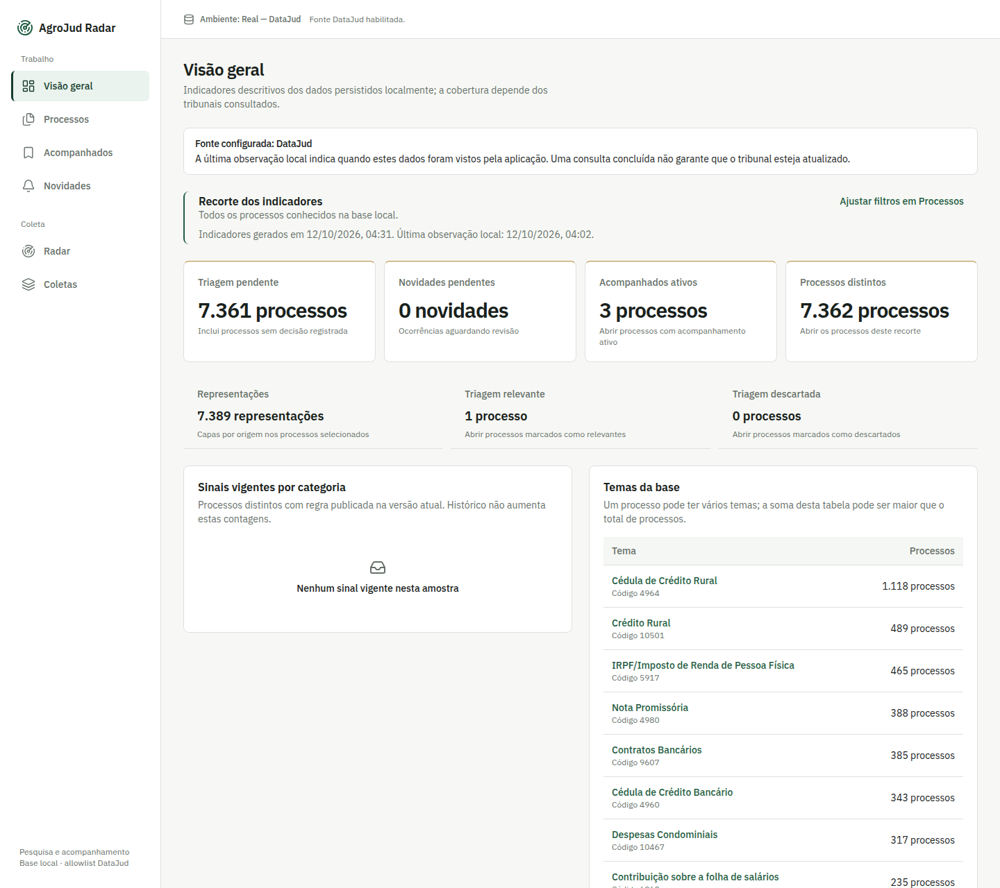
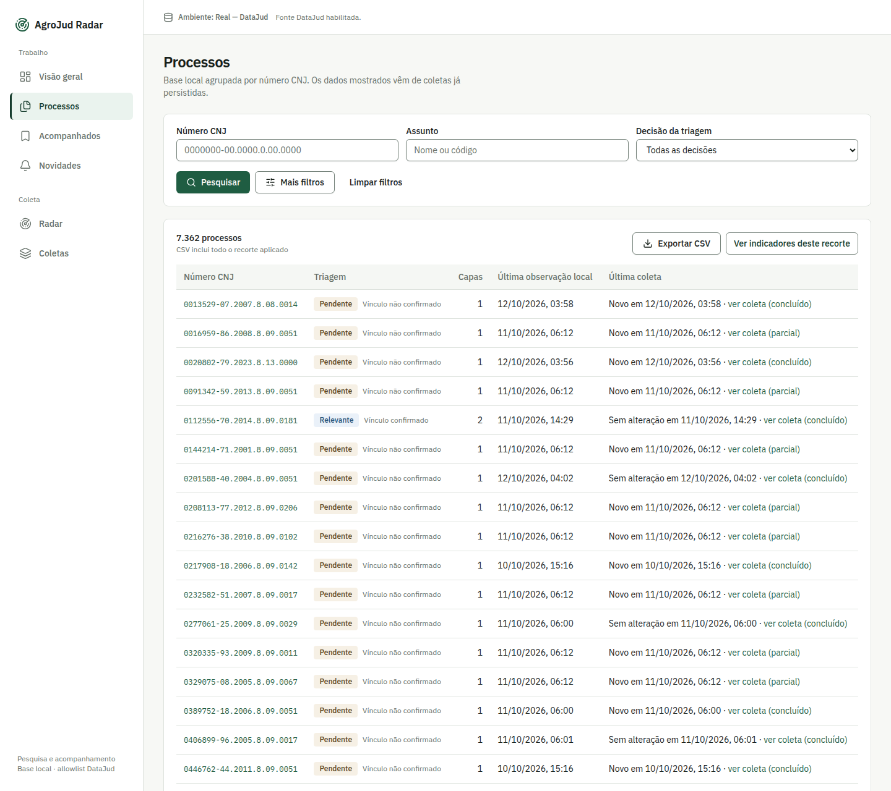
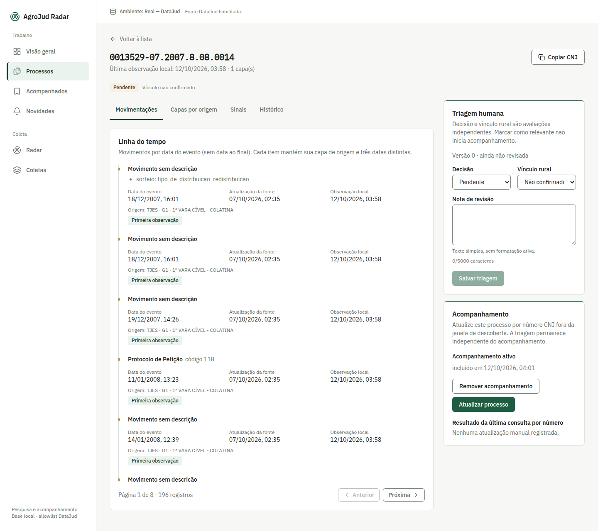
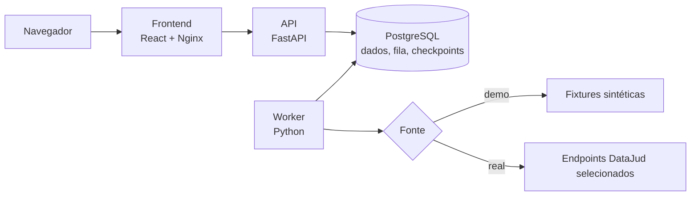

# AgroJud Radar

**O AgroJud Radar organiza a descoberta, a revisão e o acompanhamento de processos judiciais públicos potencialmente relacionados ao agronegócio.** A partir dos metadados do DataJud/CNJ, permite consultar temas jurídicos, criar buscas personalizadas, registrar decisões de triagem e acompanhar novas informações nos processos selecionados.

O sistema funciona localmente para um único usuário. Os resultados apoiam a revisão humana; não confirmam automaticamente vínculo rural nem substituem a consulta ao tribunal ou a análise jurídica.

`React` · `TypeScript` · `FastAPI` · `PostgreSQL` · `Docker Compose`

[Telas](#telas) · [Como usar](#como-usar) · [Arquitetura](#arquitetura) · [Demo e real](#demonstração-e-ambiente-real) · [Executar a demo](#executar-a-demonstração) · [Configurar com IA](#configurar-o-ambiente-real-com-uma-ia) · [Limitações](#limitações) · [Documentação](#documentação)



<sub>Captura do ambiente real em 12/10/2026. Os indicadores descrevem somente a base local observada e não representam cobertura dos tribunais.</sub>

## O que o sistema faz

- **Busca e coleta:** oferece temas oficiais e buscas personalizadas por classes e assuntos. Consulta os tribunais selecionados em segundo plano, com progresso e ponto de retomada independentes.
- **Consolidação:** agrupa resultados por número CNJ, preserva os registros de cada origem e exibe movimentações com datas e procedência.
- **Revisão humana:** registra triagem e histórico de decisões, com sinais estruturados vinculados às evidências disponíveis.
- **Acompanhamento:** atualiza processos selecionados, organiza novidades para revisão e oferece indicadores da base local e exportação CSV.

## Telas

As capturas foram obtidas no ambiente real do AgroJud em 12/10/2026. Os registros e indicadores refletem a base local naquele momento; não comprovam cobertura geral dos tribunais.

| Processos e sugestões de filtro | Detalhe e movimentações |
| --- | --- |
|  |  |
| Lista da base local com filtros e sugestões de valores. | Timeline por origem e painel de triagem humana. |

## Como usar

O menu lateral reúne **Coleta** (Radar e Coletas) e **Trabalho** (Visão geral, Processos, Acompanhados e Novidades). O uso típico segue este ciclo:

1. **Escolher o que buscar no Radar.** Em *Temas do sistema*, consulte os critérios de Crédito e contratos rurais, Recuperação judicial ou Execuções relacionadas ao agro. Em *Minhas buscas*, crie uma busca personalizada do zero ou duplique um tema, selecionando classes e assuntos do catálogo disponível. Edições criam versões e preservam o histórico; arquivar retira a busca das novas seleções sem apagar as versões anteriores.
2. **Definir e iniciar a coleta.** Selecione os tribunais (os 33 vêm selecionados inicialmente) e o período de ajuizamento. O limite de registros é opcional e cumulativo por tribunal: em branco, a consulta prossegue até receber uma página vazia; ao atingir um limite informado, termina como parcial. O tamanho de página controla quantos registros são solicitados por chamada, com padrão de 5.000 e faixa de 10 a 10.000. Confira o resumo antes de enviar.
3. **Acompanhar a execução em Coletas.** Cada tribunal tem progresso, ponto de retomada e erro próprios; o grupo resume o estado geral e pode terminar parcialmente. Coletas ativas se atualizam na tela; conforme o estado, é possível cancelar, retomar, continuar ou reiniciar a varredura.
4. **Explorar a base em Processos.** Os resultados aparecem agrupados por número CNJ, preservando os registros por tribunal. Filtre por tribunal, número, assunto, tema, classe, órgão julgador, preset, coleta ou categoria de sinal; os campos sugerem valores da base. *Exportar CSV* considera o recorte filtrado inteiro, além da página visível, respeitando o limite configurável de 50.000 processos por padrão. Se o recorte exceder esse limite, a exportação é recusada; refine os filtros.
5. **Revisar um processo.** O detalhe reúne capas por origem, movimentações e sinais estruturados, como leilão ou recuperação judicial, com links para as evidências. No painel de triagem, classifique o processo como pendente, relevante ou descartado e, se for o caso, confirme manualmente o vínculo rural com uma nota. Cada decisão fica no histórico.
6. **Acompanhar processos de interesse.** Use *Acompanhar processo* no detalhe. A página *Acompanhados* lista esses processos, atualizados diariamente às 06h, no fuso `America/Sao_Paulo`, ou sob demanda. Cada atualização consulta os tribunais das representações já conhecidas.
7. **Revisar novidades e indicadores.** Em *Novidades*, revise o que foi observado depois da referência local de cada processo acompanhado, distinguindo a data do evento da data em que ele foi observado. Na *Visão geral*, consulte indicadores da amostra salva localmente e dos tribunais selecionados; eles não medem risco jurídico nem o total de processos de um tribunal ou do país.

**Buscas personalizadas e buscas salvas têm funções diferentes.** *Minhas buscas* define os critérios temáticos. *Buscas salvas* guarda a versão dos critérios e os parâmetros de execução, como tribunais e período, para reutilização e atualização diária opcional às 06h, no fuso `America/Sao_Paulo`. Editar uma definição personalizada não reescreve os critérios das execuções anteriores nem das revisões já salvas.

O tema **Execuções relacionadas ao agro** permanece indisponível no ambiente real enquanto sua consulta combinada não tiver a validação exigida. Os critérios e limites estão na [SPEC-027](specs/SPEC-027-temas-e-buscas-personalizadas.md).

As ações que consultam o DataJud dependem do worker ativo e, no ambiente real, de chave configurada. Falhas da fonte permanecem visíveis como erro ou resultado parcial, sem serem apresentadas como ausência de processos.

## Arquitetura

API e worker são processos separados do mesmo backend. O PostgreSQL atende tanto a persistência quanto a fila de jobs, sem infraestrutura adicional.



| Parte | Responsabilidade |
| --- | --- |
| Interface | React, TypeScript e Vite; servida por Nginx no Compose. |
| API | FastAPI e Pydantic; o contrato OpenAPI gera os tipos do frontend. |
| Worker | Processo Python separado que consome jobs persistidos. |
| Persistência | PostgreSQL para processos, decisões humanas, fila, leases e checkpoints. |
| Fontes | Fixtures determinísticas em `demo`; integração DataJud separada em `real`, usando os endpoints selecionados da allowlist, sem fallback entre fontes. |

Decisões que orientam o backend:

- Chamadas HTTP externas acontecem fora de transações; página e checkpoint são gravados atomicamente sob posse válida do job.
- Leituras não escrevem, e a ingestão preserva decisões humanas já registradas.
- Falha da fonte é tratada como erro, nunca como resultado vazio.

## Demonstração e ambiente real

Os dois ambientes rodam o mesmo código, mas são isolados por projeto Compose, banco e arquivo de configuração. Não há fallback entre eles: se a fonte real falhar, o sistema não troca para dados sintéticos.

| | Demonstração | Ambiente real |
| --- | --- | --- |
| Finalidade | Conhecer a interface sem credenciais | Consultar processos nos tribunais DataJud selecionados |
| Fonte de dados | Fixtures sintéticas determinísticas | API pública DataJud/CNJ |
| Configuração | `.env.demo` (a partir de `.env.demo.example`) | `.env.real` (a partir de `.env.real.example`) |
| Credenciais | Nenhuma externa | Chave DataJud e senha própria do banco |
| Pré-condição | Docker Engine e Docker Compose | Docker, Compose e aceite dos [termos do CNJ](https://datajud-wiki.cnj.jus.br/api-publica/termo-uso/) |

O produto permite selecionar um, vários ou todos os 33 tribunais cadastrados: os 26 TJs estaduais, TJDFT e TRF1 a TRF6. Todos vêm selecionados inicialmente no Radar. A mesma chave DataJud configurada no backend atende às consultas, com execuções, resultados e falhas separados por tribunal. O suporte no produto não comprova disponibilidade externa em todos os endpoints: a evidência multitribunal continua parcial e não há afirmação de cobertura nacional. Consulte [SPEC-024](specs/SPEC-024-validacao-multitribunal-datajud.md) para o estado atual da validação e [SPEC-025](specs/SPEC-025-suporte-multitribunal.md) para os limites do runtime.

O termo do DataJud descreve o uso não comercial e contém restrições sobre distribuição de informações derivadas. Leia os [termos vigentes](https://datajud-wiki.cnj.jus.br/api-publica/termo-uso/) antes de usar ou publicar esse conteúdo.

## Executar a demonstração

Requer Docker Engine e Docker Compose. O Compose constrói os serviços, então não é necessário instalar Python ou Node.js no host.

```sh
if [ ! -f .env.demo ]; then cp .env.demo.example .env.demo; fi

compose() {
  docker compose --project-name agrojud-demo --env-file .env.demo -f compose.yaml "$@"
}

compose up --detach --wait db
compose run --rm --no-deps api uv run --no-sync alembic upgrade head
compose --profile worker up --build --detach --wait api frontend worker
```

| Serviço | Endereço padrão |
| --- | --- |
| Interface | <http://127.0.0.1:5173> |
| API | <http://127.0.0.1:8000> |
| Documentação interativa da API | <http://127.0.0.1:8000/api/v1/docs> |

Se as portas estiverem ocupadas, ajuste `FRONTEND_PORT` e `API_PORT` em `.env.demo`.

Para parar os serviços sem remover o banco persistente:

```sh
docker compose --project-name agrojud-demo --env-file .env.demo -f compose.yaml --profile worker stop
```

## Configurar o ambiente real com uma IA

O prompt abaixo orienta uma IA de programação com acesso ao terminal a configurar o ambiente real conforme a documentação do projeto e verificar os serviços locais. A disponibilidade das consultas depende da configuração e da fonte externa.

Antes de usar, considere:

- **Pré-requisitos no computador são instalados por você.** Se faltar Git, Docker, Docker Compose ou outra ferramenta exigida, a IA informa o que falta. O procedimento permite baixar imagens Docker e instalar dependências dentro dos containers.
- **O uso da API DataJud depende dos termos do CNJ.** A IA resume os termos e pede sua confirmação; ela não aceita em seu nome.
- **Segredos ficam locais.** Senha do banco e chave da API são gravadas apenas na configuração do backend e não devem aparecer na conversa.

<details>
<summary>Mostrar prompt de configuração do ambiente real</summary>

```text
Clone e configure o AgroJud Radar no ambiente real para eu usar. Execute o trabalho você mesmo; não fique só me dando instruções.

Repositório: https://github.com/Duarte0/AgroJud.git

Regras:
- Não instale ou atualize programas no sistema hospedeiro e não peça senha de administrador. É permitido baixar imagens Docker e instalar dependências dentro dos containers conforme os arquivos do projeto. Se faltar algum pré-requisito no computador, diga o que falta e o link oficial de instalação, espere eu instalar e continue de onde parou.
- Use somente o ambiente real. Nunca use a demonstração, fixtures ou dados sintéticos como substituto.
- Nunca mostre senhas, chaves ou o conteúdo do arquivo de configuração real, nem grave segredos em arquivos versionados.
- Preserve dados e alterações existentes: não sobrescreva arquivos, não apague volumes ou bancos e não faça reset. Se algo exigir isso, pare e me pergunte.
- Não esconda falhas. Se uma etapa falhar, explique o erro e o que você tentou.

Passos:
1. Se o diretório atual já for um clone deste repositório, use-o. Caso contrário, clone em uma pasta nova.
2. Antes de executar qualquer coisa, leia README.md, AGENTS.md, a documentação de operação em docs/, as SPEC-024 a SPEC-027, o exemplo de configuração do ambiente real, o compose.yaml e os scripts em scripts/. Descubra a partir deles os pré-requisitos, os comandos, as portas e o procedimento atual para o ambiente real. Não presuma comandos que o repositório não documenta.
3. Verifique se os pré-requisitos encontrados estão disponíveis.
4. Crie a configuração do ambiente real a partir do exemplo, se ainda não existir. Garanta que ela seja ignorada pelo Git e acessível só ao meu usuário. Gere uma senha forte para o banco sem exibi-la. Se já existir um banco real com credenciais diferentes, pare e me avise.
5. Se a chave DataJud não estiver configurada, obtenha a chave pública vigente na página oficial https://datajud-wiki.cnj.jus.br/api-publica/acesso/. Se não conseguir, peça para eu inseri-la diretamente no arquivo.
6. Leia os termos em https://datajud-wiki.cnj.jus.br/api-publica/termo-uso/, resuma para mim os limites de uso, incluindo a finalidade não comercial, e peça minha confirmação explícita. Sem ela, não ative nada que consulte o DataJud.
7. Aplique as migrations e suba os serviços seguindo o procedimento documentado no repositório. Se já existir um banco real, faça antes um backup com a ferramenta do repositório, fora da pasta do projeto. Se portas estiverem ocupadas, ajuste a configuração de forma consistente. Ative o worker somente depois do meu aceite. Não crie consultas nem faça chamadas de teste ao DataJud.
8. Confira os endpoints de saúde da API e a interface. Ao final, informe as URLs, o estado dos serviços e o comando para parar o ambiente sem perder dados.
```

</details>

## Limitações

- **Uso local e individual.** O projeto opera localmente para um usuário e não tem autenticação.
- **Sem autorização de uso comercial.** O projeto não declara autorização para uso profissional ou comercial. O uso dos dados é regido pelas orientações de [acesso](https://datajud-wiki.cnj.jus.br/api-publica/acesso/) e pelos [termos vigentes do CNJ](https://datajud-wiki.cnj.jus.br/api-publica/termo-uso/).
- **Cobertura não garantida.** Uma coleta concluída descreve aquela consulta; não comprova cobertura integral nem atualização completa do tribunal. A validação externa multitribunal permanece parcial, conforme [SPEC-024](specs/SPEC-024-validacao-multitribunal-datajud.md); suporte a um endpoint na interface não prova que ele esteja disponível.
- **Regra de penhora desabilitada no real.** As evidências técnicas e seus limites estão na [SPEC-020](specs/SPEC-020-operacao-e-aceite-integrado.md).
- **Escopo dos dados e das funções.** Não há pesquisa por nomes de partes ou CPF/CNPJ, identificação automática de produtores, acesso a peças integrais nem controle de prazos processuais.

## Documentação

Para executar as verificações de backend, frontend, contrato OpenAPI e jornada Playwright, consulte [Testes e contrato frontend/API](docs/operacao-e-aceite-integrado.md#testes-e-contrato-frontendapi). As SPECs registram resultados, datas e limites das validações; testes locais com dados sintéticos não comprovam disponibilidade externa do DataJud.

| Documento | Conteúdo |
| --- | --- |
| [PRD](PRD.md) | Requisitos do produto |
| [Plano de implementação](IMPLEMENTATION_PLAN.md) | Fases e contratos de implementação |
| [Índice das SPECs](specs/README.md) | Especificações, dependências, status e evidências |
| [SPEC-024 — Validação multitribunal](specs/SPEC-024-validacao-multitribunal-datajud.md) | Evidências externas parciais por tribunal e preset |
| [SPEC-025 — Suporte multitribunal](specs/SPEC-025-suporte-multitribunal.md) | Seleção de tribunais, grupos e limites do runtime |
| [SPEC-026 — Eficiência da coleta](specs/SPEC-026-eficiencia-coleta-multitribunal.md) | Paginação, limite opcional, benchmark e probe TJGO limitada |
| [SPEC-027 — Temas e buscas personalizadas](specs/SPEC-027-temas-e-buscas-personalizadas.md) | Critérios estruturados, versões, arquivamento e limites de validação real |
| [Operação e aceite integrado](docs/operacao-e-aceite-integrado.md) | Migrations, jobs, backup, testes e recuperação |
| [Frontend](frontend/README.md) | Detalhes do frontend e do contrato OpenAPI |
